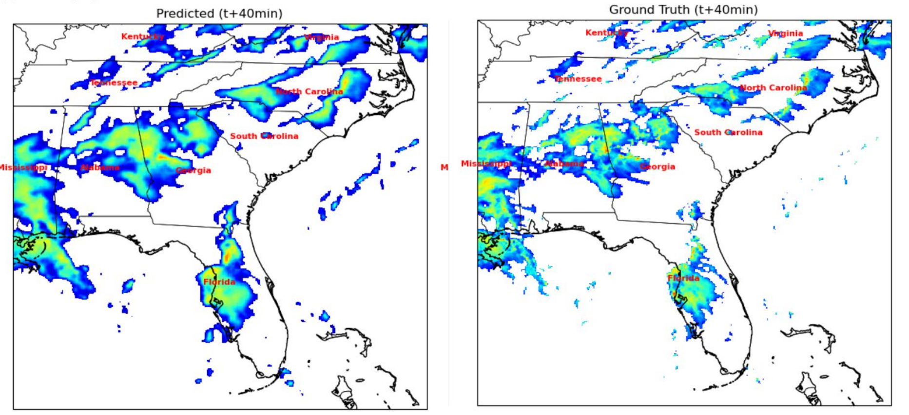
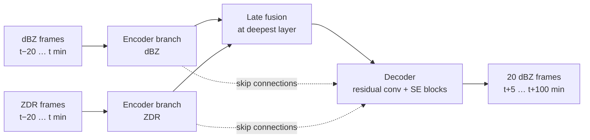

# Nowcasting Heavy Rainfall in the Southeastern US with Deep Learning

> **Case study.** This was a research project in the **Duke University Data+ / Climate+ 2025**
> program, where I took part through the **KAUST Academy**. The source code and trained
> weights belong to the research group and are not public. This page describes the problem,
> the approach, the results and what I learned. I'm happy to walk through the implementation
> in an interview.

We trained **FURENet**, a multi-branch U-Net for radar nowcasting (Pan et al., 2021), to
predict radar reflectivity up to 100 minutes ahead over the Southeastern US. It uses two
inputs: reflectivity (**dBZ**) and a polarimetric variable, differential reflectivity
(**ZDR**). At a 40-minute lead time it detects **84%** of rain areas (≥15 dBZ) and **66%**
of intense convective cores (≥35 dBZ).

Left: the model's forecast 40 minutes ahead. Right: what the radar actually observed.
Storm locations over Georgia, Alabama, Florida and the Carolinas are captured well, but the
forecast is smoother and more spread out than reality (see *What I learned*).

## The problem

The Southeastern US gets frequent summer convective storms that grow and decay within an
hour. Numerical weather models are expensive to run and struggle at these short time and
space scales. **Nowcasting** extrapolates recent radar observations forward instead, to warn
about flash floods 0 to 2 hours ahead. The goal was a deep learning nowcaster that is cheap
to run, precise for *heavy* rain, and able to generalise across the region.

## Data

| | |
|---|---|
| Source | **MRMS** (Multi-Radar Multi-Sensor, NOAA). Reflectivity (dBZ) every 2 min, differential reflectivity (ZDR) every 5 min, at 3 km height |
| Event selection | 21 heavy-rainfall days in June to August 2024, identified from NOAA **CPC** precipitation data |
| Grid | 384 × 384 pixels covering the Southeastern US |
| Preprocessing | Radar fields converted to images and normalised (dBZ 0–65, ZDR −1 to 5), then aligned onto a common 5-minute time grid |
| Samples | Sliding windows of 5 input frames (25 min of history) → 20 output frames (5 to 100 min ahead) |

**Why ZDR?** Reflectivity shows *how much* precipitation there is. ZDR shows *drop shape and
size*: large, flattened drops mean active, intense convection. That tells the model whether a
storm is growing or dying, which reflectivity alone cannot show.

## Model

- **FURENet** (Pan et al., 2021) is a U-Net with **one encoder branch per radar variable**. The branches are fused only at the deepest layer (late fusion), so each variable learns its own features first.
- **Squeeze-and-excitation (SE) blocks** in the decoder re-weight the channels, so the network can learn which fused features matter most.
- **Rain-weighted MSE loss.** Pixel errors are weighted by rain intensity: 1× under 2 mm/h, 2× for 2–5, 5× for 5–10, 10× for 10–30 and 30× above 30 mm/h. Without this, the loss is dominated by the huge share of dry pixels, and the model learns to under-predict heavy rain, which is exactly what we care about.
- **Training:** AdamW (lr 3×10⁻⁴, weight decay 10⁻⁴) with warm-up and a multi-step learning-rate schedule, on one GPU of the Duke Compute Cluster (Slurm). Validation loss reached its minimum (about 0.0010) around epoch 25 of 28.

## Results

**Skill at a 40-minute lead time** (categorical scores at two reflectivity thresholds):

| Metric | ≥ 15 dBZ (rain) | ≥ 35 dBZ (convective cores) |
|---|---|---|
| Probability of detection (hit rate) ↑ | **0.843** | **0.664** |
| False alarm ratio ↓ | 0.138 | 0.344 |
| Heidke skill score (vs. random forecast) ↑ | **0.846** | **0.657** |

**What training data matters:**

| Training data | CSI ↑ |
|---|---|
| Heavy-rain days only, dBZ only | 0.53 |
| All days from the 3 months, dBZ only | 0.50 |
| **Heavy-rain days only, dBZ + ZDR** | **0.76** |

CSI (critical success index) = hits / (hits + misses + false alarms). Unlike accuracy, it
ignores the easy "no rain, correctly predicted" pixels that dominate radar images, so it
only rewards getting the rain itself right.

Two findings:
1. **Curating the event days helps.** Training only on heavy-rain days did slightly better than using every day from the same three months. Most days are quiet, and they teach the model little about intense storms.
2. **The polarimetric input helps most.** Adding ZDR raised CSI from 0.53 to 0.76. This is in line with Pan et al. (2021), who found polarimetric variables improve forecasts of convective development.

## What I learned

- **MSE produces blurry forecasts.** Pixel-wise loss rewards hedging, so predicted storms come out smoother and larger than observed. This is well known in nowcasting. Fixes include adversarial or perceptual losses and generative models, plus spatial metrics such as the Fractions Skill Score, which don't punish a slightly displaced storm twice.
- **Split by day, not by sample.** Our samples are overlapping sliding windows. A 5-minute shift between two windows leaves them sharing 24 of 25 frames, so a random sample-level split puts near-duplicates in train and validation. The scores above are therefore optimistic. Holding out **entire storm days** (or whole weeks) gives an honest estimate of performance on unseen events. It is the first thing I would change.
- **Skill decays with lead time.** Beyond about 1 hour, forecasts degrade noticeably, which is expected for extrapolation-based nowcasting. Blending with numerical weather prediction at longer lead times is the standard answer.
- **Storage and compute shape the design.** Three months of 2-minute radar over a 384×384 domain adds up quickly. Converting to images and selecting event days kept training feasible on a shared GPU cluster.

## Next steps

1. Re-evaluate with a day-level held-out split and report skill against lead time (5 to 100 min).
2. Add more years and seasons (not only summer) to test generalisation.
3. Add more inputs: specific differential phase (KDP), wind vectors and water vapour (we explored CONUS404 water vapour and 850 hPa winds).
4. Try a loss or architecture that keeps storms sharp (GAN or diffusion nowcasting), and evaluate with the Fractions Skill Score.

## Tech stack

PyTorch · U-Net / FURENet with SE blocks · MRMS radar data · NOAA CPC · OpenCV · Duke Compute Cluster (Slurm, GPU)

## Team

**Suhaib Mansour** (Duke University), **Zijin Ye** (Carnegie Mellon University), **Maan Adam**
(KAUST Academy), mentored by **Dr. Yan Pan** (Nicholas School of the Environment, Duke University).

**Maan Adam** · [LinkedIn](https://www.linkedin.com/in/maan-adam-b57320245)

## References

- Pan, X., Lu, Y., Zhao, K., Huang, H., Wang, M., & Chen, H. (2021). Improving nowcasting of convective development by incorporating polarimetric radar variables into a deep-learning model. *Geophysical Research Letters*, 48(21), e2021GL095302.
- Zhang, J., et al. (2016). Multi-Radar Multi-Sensor (MRMS) quantitative precipitation estimation: Initial operating capabilities. *Bulletin of the American Meteorological Society*, 97(4), 621–638.
- Ronneberger, O., Fischer, P., & Brox, T. (2015). U-Net: Convolutional networks for biomedical image segmentation. *MICCAI*.
- Hu, J., Shen, L., & Sun, G. (2018). Squeeze-and-excitation networks. *CVPR*.
